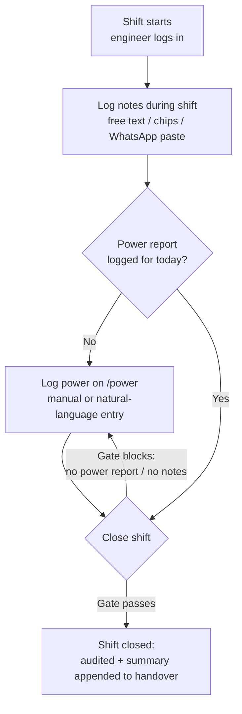

# MyShift — Review, Improvements & MVP Roadmap

*Based on a code review of [myshift.py](https://github.com/jaycode100-sys/elnoc/blob/master/app/routers/myshift.py), [myshift.html](https://github.com/jaycode100-sys/elnoc/blob/master/app/templates/myshift.html), [power.py](https://github.com/jaycode100-sys/elnoc/blob/master/app/routers/power.py), `models.py`, `main.py` and the `tests/` tree of the [elnoc repo](https://github.com/jaycode100-sys/elnoc) (master, reviewed 2026-11-01).*

---

## 1. What MyShift is today

MyShift is the per-shift engineer console inside ELNOC. An engineer logs what happened on their shift (notes, extra info, power status), and the shift is not supposed to close unless a power report exists for the date.

**Verified components**

| Piece | What it does |
| --- | --- |
| `GET /myshift` | Page: date picker, close-gate banner, notes form with quick chips, notes list, WhatsApp paste card, sidebar shift panel |
| `POST /api/myshift/note` | Saves a `ShiftNote` (notes, extra info, power status) |
| `GET /api/myshift/notes` | Lists the current engineer's notes for a date + shift |
| `GET /api/myshift/can-close` | Reports whether the shift can close (power report exists for the date) |
| `POST /api/myshift/whatsapp-paste` | Parses pasted chat text (time, battery %) into a shift note |
| `ShiftNote` model | engineer, shift_date (DD/MM/YYYY string), shift (day/night), notes, extra_info, power_status, created_at |
| Gate rule | "Can close" = a `PowerReport` row exists for today's date |

Shifts are labelled **day** (07:00–18:59 Lagos) or **night**, computed at request time. Power reports come from the separate **Power** console (`/power`), which also has an agentic natural-language entry (`POST /api/power/agent`).

---

## 2. What works well

- **Right shape for the job.** One page, one job: notes in, gate checked, shift closed. No ceremony.
- **The gate idea is sound.** Making the power log a hard precondition of shift close creates daily accountability, mirroring the handover gate philosophy (visible, never a silent pass).
- **WhatsApp paste meets engineers where they are.** Escalations already live in WhatsApp; paste-in is the lowest-friction capture path.
- **Quick chips cut typing.** "Power restored / Gen on battery / Handover done" one-click fills match the three most common entries.
- **Consistent with ELNOC.** Same auth (`get_current_user`), same Jinja/templates, same styling — it looks native, and the router is correctly mounted in `main.py`.
- **Per-engineer scoping.** Notes are filtered by `user.username`, so nobody edits anyone else's shift record.

---

## 3. Issues found (review)

### Critical

1. **The close gate is advisory, not enforced.** `can-close` only *reports* state. There is no `POST /api/myshift/close` endpoint, no `ShiftClose` record, no audit entry, and nothing downstream (e.g. handover) checks it. A shift "closes" when the engineer walks away — the gate can be ignored entirely. **This is the single biggest gap.**
2. **Model contract vs. behaviour.** The `ShiftNote` docstring says *"One per engineer per shift per date"*, but `POST /api/myshift/note` appends a new row every time — duplicates are silently allowed. Decide which behaviour is intended (see §5, P1-2).

### Bugs / fragility

3. **Two date formats meet in the middle.** `shift_date` is stored as `DD/MM/YYYY`, but the page's `<input type="date">` produces `YYYY-MM-DD`; correctness depends on the `goDate()` JS converting at every entry point. One missed conversion silently queries the wrong date.
4. **String date sorting is wrong.** `power.py` orders distinct dates with `order_by(PowerReport.report_date.desc())` — lexicographic ordering puts `01/02/2026` *after* `31/01/2026`. The date picker list will misorder across month boundaries.
5. **Shift label is computed at save/read time.** An engineer who writes the day's final note at 19:05 gets it filed as "night". Notes near the 07:00/19:00 boundary can split across shifts.
6. **WhatsApp battery regex grabs any percentage.** `re.search(r"([0-9]{1,3}%)", raw)` matches the first `%` in the text — a packet-loss figure ("loss 5%") would be stored as battery level. The parsing also duplicates `power.py`'s `_parse_battery_level` / `_parse_time` instead of reusing them.

### Gaps

7. **No edit or delete for notes.** A typo or a bad paste is permanent. This conflicts with the handover gate's "never a dead end" philosophy.
8. **No audit trail.** Note creation and (future) closing write nothing to `AuditLog`, unlike handover overrides.
9. **`can-close` ignores notes entirely.** A shift can "close" with zero notes written. Consider requiring ≥1 note or an explicit "nothing to report" flag.
10. **Unvalidated payloads.** Every endpoint takes `payload: dict` instead of Pydantic models (`schemas.py` already exists in the repo). Only the fully-empty case is rejected.
11. **No tests for MyShift or Power.** The `tests/` tree has 15 files (alerting, handover, intake, adapters, pane, LLM…) — none cover `myshift.py` or `power.py`, even though the gate is exactly the kind of rule that regresses silently.
12. **Undocumented.** MyShift and Power are absent from `README.md` and `USER_GUIDE.md`, have no FR-IDs in the design doc, and aren't in the pilot checklist.
13. **Mobile loses the sidebar.** At ≤1000px the stylesheet does `.myshift-sidebar{display:none}` — the shift status panel and close affordance vanish exactly on the device field engineers use.
14. **Duplicated helpers.** `_lagos_date()`, `POWER_SOURCES`, and shift-labelling logic are repeated across `myshift.py` and `power.py`.

---

## 4. Suggested improvements — prioritized

### P1 — Make the gate real (≈1–2 days)

| # | Improvement |
| --- | --- |
| P1-1 | Add a `ShiftClose` model (engineer, shift_date, shift, closed_at, power_report_id, override_reason nullable). Add `POST /api/myshift/close`: validates power report + ≥1 note (or explicit "nothing to report"), writes an `AuditLog` entry, rejects double-close. The Close button calls it; the banner reflects a *closed* state; admins can reopen for corrections. |
| P1-2 | Resolve the duplicate question: keep timeline behaviour (multiple notes OK — recommended; it's what the UI already implies) and fix the docstring, **or** upsert one note per engineer/shift/date. |
| P1-3 | Normalise dates: store ISO `YYYY-MM-DD` (or a proper `Date` column) and format as `DD/MM/YYYY` only at render; fix the distinct-date ordering bug in `power.py`. |
| P1-4 | Store the shift label on the note at save time, defaulted from the clock but overridable by the user (a small day/night toggle on the form). |
| P1-5 | Add `PATCH /api/myshift/note/{id}` and `DELETE /api/myshift/note/{id}`, allowed until shift close (or 24h), audit-logged. |
| P1-6 | Replace `payload: dict` with Pydantic schemas. |
| P1-7 | Move the close button/status into the main column at mobile widths (keep the sidebar as a desktop nicety). |
| P1-8 | Tests: gate blocks without power; passes with; double-close rejected; boundary-shift labelling; date normalisation. |
| P1-9 | Document: add a MyShift section to `README.md` and `USER_GUIDE.md`; assign FR-IDs in the design doc. |

### P2 — Integration (≈2–4 days)

| # | Improvement |
| --- | --- |
| P2-1 | **Close → handover.** When a shift closes, append a "Shift summary" section (notes + power digest) to the handover document, reusing the existing handover services and exact 11-Oct format. MyShift then feeds the handover instead of living beside it. |
| P2-2 | **WhatsApp paste → routing.** Run pastes through the agentic power parser (`/api/power/agent`): power events become `PowerReport` rows (which satisfy the gate), the remainder stays a shift note. Show a classification preview before saving so the engineer confirms what went where. |
| P2-3 | **Note ↔ case linking.** Optional `case_id` on a shift note, rendered as a chip; the case page shows "mentioned in N shift notes". |
| P2-4 | **Shift roster.** Assign engineers to day/night per date (CSV seed is enough for MVP); MyShift shows "your shift", leads see coverage; shift label comes from the roster, not the clock. |
| P2-5 | **Copy-for-handover button.** One click copies the shift summary as text (same pattern as Copy-for-Phoenix) for teams still assembling handovers in WhatsApp. |
| P2-6 | **Lead view.** `GET /api/myshift/summary?date=` returning every engineer's note count, power status, and close state; a small table under the existing admin area. |
| P2-7 | **Extract shared helpers** (`app/services/shift.py`): `_lagos_date`, `shift_label`, `POWER_SOURCES`, battery/time parsing — one home, both routers use it. |

### P3 — Insights & polish (later)

| # | Improvement |
| --- | --- |
| P3-1 | **Shift digest on the dashboard/weekly report**: notes count, power events, open cases at handover, acks per shift. |
| P3-2 | **Nudge**: 30 min before shift end, if no power report, send the team a WhatsApp/template reminder via the existing notify dispatcher. |
| P3-3 | **Power trends**: which source ran, for how long, battery trajectory per day — small chart on `/power` (data is already captured). |
| P3-4 | **Search across shift notes** (reuse `app/services/search.py` patterns) so "who saw this before?" is answerable. |
| P3-5 | **Desktop pane tab**: a MyShift tab in the ELNOC Quick-Log pane (`Ctrl+Shift+M`) for one-keystroke note logging without the browser. |

---

## 5. The workable MVP

**Goal:** an engineer can run a whole shift — capture, gate, close, handover — in under a minute of total interaction, and a lead can verify it happened.

**In scope**

- Auth + per-engineer notes (create, list, edit/delete until close) with chips and free text
- WhatsApp paste (with power-event routing from P2-2, since it directly feeds the gate)
- Power log (existing `/power` page + agentic entry) unchanged
- **Enforced close**: gate checks power report + at least one note (or "nothing to report"), audits, stamps the handover
- Close state visible on the page and to leads

**Out of scope for MVP:** AI summarisation of notes, roster management UI (seed CSV is fine), charts, reminders, offline mode.

**Acceptance criteria**

1. Closing without a power report fails with a clear message; the failure is visible on the page.
2. Closing with a power report and notes succeeds exactly once; second attempt is rejected.
3. Every close writes an `AuditLog` row with engineer, date, shift, and power report reference.
4. A closed shift appends a summary section to the handover document.
5. Notes can be corrected until close; after close they are read-only (admin reopen excepted).
6. Mobile shows the gate and close action in the main column.
7. `pytest -q` covers the gate, close, and boundary-shift rules.

**Shift lifecycle**



---

## 6. Flexible best means of use

**Entry modes** (keep all three; they serve different moments):

1. **Browser** — the full console at `/myshift`; best at start and end of shift.
2. **WhatsApp paste** — mid-shift capture with zero context switch; the engineer never leaves the chat.
3. **Power log** — `/power` page or its agentic natural-language box ("Generator on at 6:15 PM, inverter 68%"); power events recorded here are what satisfy the gate.

**Deployment options**

- **Inside ELNOC (current).** Zero extra work; MyShift shares auth, audit, notify, and handover. Recommended default.
- **Standalone later.** `myshift.py` is nearly self-contained — it depends on `models`, `security`, `database`, `utils_time`, and `base.html`. If a sister team wants just the shift console, it can be lifted into a small FastAPI+SQLite app in about a day once P1 lands. Don't do this before the gate is enforced.

**Permission shape**

- Every authenticated user logs **their own** shift only (already enforced by username filtering).
- Add: admin/lead view of all engineers' shifts (`?engineer=` filter) — read-only by default.

**Data-entry flexibility**

- All endpoints speak JSON, so a future PWA with an offline queue can replay entries — keep the API payload-schema-based (P1-6) to make that safe.

---

## 7. Suggested data-model & API sketch

```python
# models.py additions
class ShiftClose(Base):
    __tablename__ = "shift_close"
    id, engineer, shift_date (ISO), shift,
    power_report_id (FK, nullable),      # snapshot of the report that satisfied the gate
    nothing_to_report (bool, default False),
    override_reason (str, nullable),
    closed_at (datetime)

# ShiftNote additions
case_id: Optional[int]   # P2-3
source: str              # manual | whatsapp | pane
updated_at: datetime
# docstring updated: timeline semantics, one row per entry
```

```python
# new endpoints (schemas validated)
PATCH  /api/myshift/note/{id}      # until close / 24h, audited
DELETE /api/myshift/note/{id}      # until close / 24h, audited
POST   /api/myshift/close          # enforces gate, audits, stamps handover
GET    /api/myshift/summary?date= # lead view (P2-6)
```

---

## 8. Documentation & test checklist

- [ ] `README.md`: MyShift + Power sections (what, where, how it gates)
- [ ] `USER_GUIDE.md`: engineer walk-through (see the companion *MyShift User Guide* document)
- [ ] Design doc: FR-IDs for the gate (e.g. FR-90 close gate, FR-91 WhatsApp routing) and §14.1 test areas
- [ ] `tests/test_myshift.py`: gate, close, double-close, edit-until-close, boundary shifts
- [ ] `tests/test_power.py`: date ordering fix, battery-parse edge cases
- [ ] Pilot checklist: add "shift closed + power logged for every day of the pilot window"